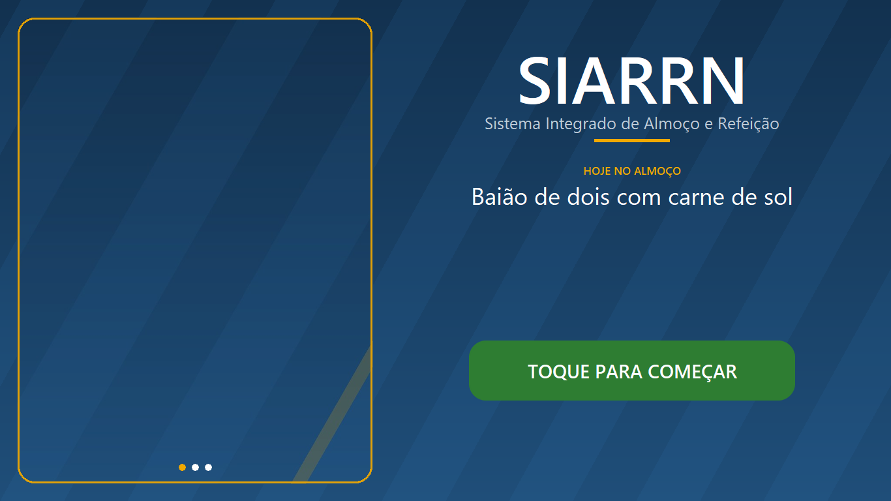
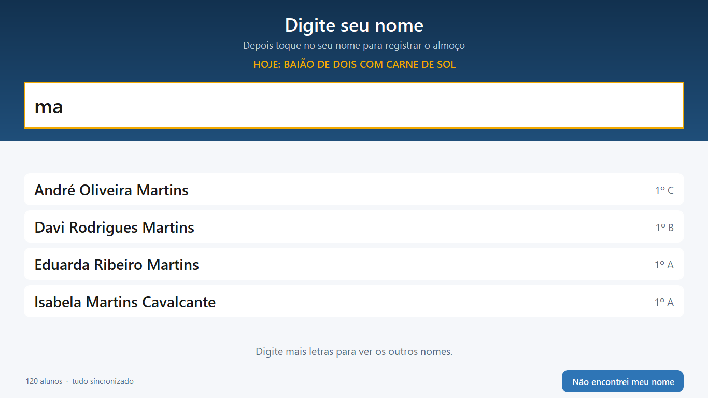
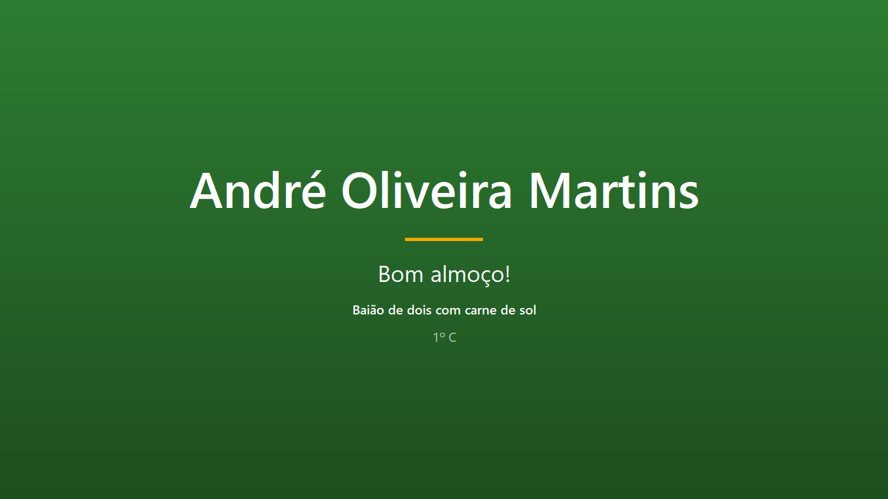
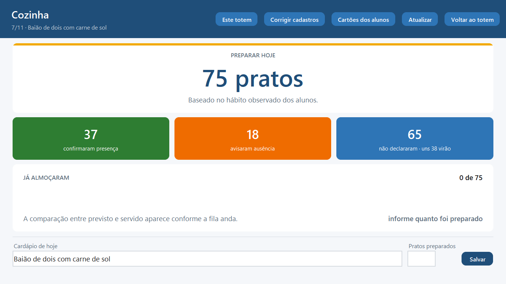
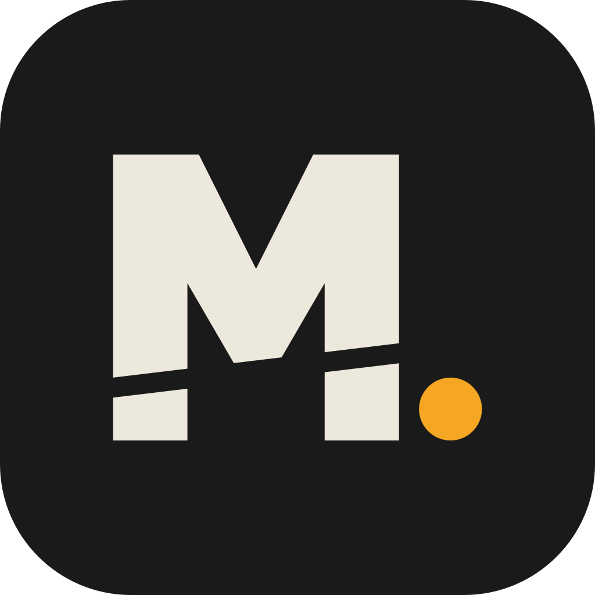

<p align="center">
  <picture>
    <source media="(prefers-color-scheme: dark)" srcset="assets/marca/logo-escuro.png">
    
  </picture>
</p>

<p align="center">
  <em>Conta quantos alunos realmente almoçam, para que a cozinha pare de preparar no chute.</em>
</p>

<p align="center">
  
  
  <a href="LICENSE"></a>
</p>

---

## O problema

A escola serve almoço para mais de cem alunos e não sabe quantos vão aparecer. Hoje alguém passa de sala em sala anotando, e repassa o total à cozinha. Um formulário online já foi tentado e não durou meio ano: dava para almoçar sem ter declarado, então declarar virou favor — e favor se esquece. O número que chegava à cozinha era ficção, e ninguém alimenta por muito tempo um número que sabe ser ficção.

O resultado prático é **sobra de comida**: o número declarado já vem inflado, e a cozinha ainda soma margem por medo de faltar.

## A ideia

O SIARRN mede o que nunca foi medido — **quem de fato almoçou** — num totem na fila, antes do balcão. A partir daí, a previsão do dia seguinte deixa de ser chute:

```
previsão = quem confirmou presença
         + Σ (taxa histórica de comparecimento de quem não disse nada)
```

Quem confirmou conta inteiro. Quem avisou ausência sai. **Quem não fez nada entra pela própria probabilidade histórica.** É isso que impede o sistema de morrer como o formulário morreu: com adesão zero às declarações ele vira média histórica pura e ainda entrega número útil; com adesão total, vira contagem exata. Não existe cenário em que ele quebre — adesão é ganho, nunca requisito.

O sistema **nunca nega comida a aluno**. Quem não confirmou passa igual; a confirmação dá fila preferencial, não direito ao prato.

---

## Telas

| | |
|---|---|
|  |  |
| **Apresentação.** O cardápio do dia, legível do outro lado do refeitório. Um toque em qualquer lugar começa. | **Busca.** Duas letras bastam. Só aparecem os nomes que cabem inteiros na tela. |
|  |  |
| **Confirmação.** O nome em verde, o que tem no prato, e a fila anda. | **Cozinha.** Quantos pratos preparar e de onde saiu o número. |

Os alunos das imagens são fictícios, gerados pelo `--seed`.

---

## Como está dividido

| Parte | Tecnologia | O que faz |
|---|---|---|
| Servidor | Python + SQLite | Guarda tudo e calcula a previsão. Roda numa máquina da escola. |
| Totem e cozinha | Python + Tkinter | Um programa, dois modos: a tela da fila e o painel da cozinha. |
| App do aluno | Kotlin + Compose | Cardápio, declaração e o QR na tela do celular. |

Nenhuma interface web: o servidor expõe só API JSON. Ele roda apenas com a biblioteca padrão do Python. O totem usa Pillow (fotos e degradês), qrcode (cartões) e OpenCV (câmera) — e degrada sem qualquer um dos três, sem que a fila pare.

As formas que o Tk não tem — cantos arredondados, degradês, botões redondos — ficam em [`siarrn/ui_formas.py`](siarrn/ui_formas.py). Só os degradês dependem de Pillow; o resto é Canvas puro e nunca some.

```bash
pip install -r requirements.txt
```

---

## Rodando

### Servidor

Precisa de Python 3.10+. Não há dependências além da biblioteca padrão.

```bash
python siarrn.py --seed
```

O `--seed` cria 120 alunos fictícios com um mês de histórico — útil para testar e para demonstrar. Sem ele, o banco começa vazio e os alunos se cadastram sozinhos no totem.

O endereço aparece no console. É ele que o totem e os celulares usam.

### Totem

```bash
python totem.py --servidor=http://192.168.0.10:8770
```

Na primeira vez que abre numa máquina, o totem pergunta o endereço do servidor e um PIN novo para a cozinha, então o `--servidor` é opcional. Tudo fica salvo em `~/.siarrn/totem.json` e pode ser trocado depois no painel da cozinha, em **Este totem**. Abre em tela cheia sem saída — é um totem, não uma janela.

Ele começa na tela de apresentação, com o cardápio do dia e as fotos de `assets/fotos/` (veja o [LEIA-ME](assets/fotos/LEIA-ME.md) de lá). Um toque leva à busca, e depois de 45 segundos parado ele volta sozinho.

Opções úteis: `--janela` roda sem tela cheia (desenvolvimento) e `--gestao` abre direto no painel da cozinha.

**Modo gestão:** três toques no rodapé, ou `Ctrl+Alt+G`, e o PIN (padrão `1234`, mude em **Este totem**).

### Conferindo a instalação

Antes de a fila se formar, dá para checar se aquela máquina enxerga o servidor:

```bash
python totem.py --verificar --servidor=http://192.168.0.10:8770
```

### Gerando os executáveis

Para instalar na escola sem depender de Python:

```bash
python build.py
```

Produz `dist/SIARRN-Servidor/` e `dist/SIARRN-Totem/` — duas pastas independentes, para copiar em pendrive. São separadas de propósito: a máquina do refeitório não carrega o servidor, e a do servidor não carrega as bibliotecas de câmera e imagem (21 MB contra 152 MB).

As fotos ficam **fora** do executável, em `dist/SIARRN-Totem/assets/fotos`, para a escola poder trocá-las sem recompilar nada.

### Gerando o app do aluno

```bash
cd app-aluno && ./gradlew assembleRelease
```

Sai em `app/build/outputs/apk/release/app-release.apk`, com **1,2 MB**. O servidor o entrega automaticamente em `http://<servidor>:8770/siarrn.apk` — o aluno abre esse endereço no navegador do celular e instala.

A chave de assinatura fica em `app-aluno/siarrn-release.jks` e **não vai para o repositório**. Guarde uma cópia fora do computador: sem ela não dá para publicar uma atualização reconhecida como sendo o mesmo app. Para gerar outra:

```bash
keytool -genkeypair -keystore siarrn-release.jks -alias siarrn -keyalg RSA -keysize 2048 -validity 10000
```

### Onde ver o que aconteceu

`~/.siarrn/servidor.log` e `~/.siarrn/totem.log`, com rotação automática. É onde procurar quando algo der errado durante o almoço — o totem fica sozinho no refeitório e ninguém está olhando um terminal.

### Testes

```bash
python -m unittest discover -s tests -t .
```

### Marca

O símbolo é um prato visto de cima com uma contagem de cinco dentro: almoço e conta. Tudo sai de um script só, com uma geometria só — o SVG, as versões da logo, o `assets/siarrn.ico` dos executáveis e os ícones do app Android:

```bash
python tools/gerar_marca.py
```

Os arquivos ficam em [`assets/marca/`](assets/marca/), na paleta do SIGBEF.

---

## O totem não pode parar

Se a rede oscilar com cem pessoas na fila, a fila não espera — e a cozinha nunca mais confia no sistema. Por isso o totem **nunca** depende do servidor para responder:

- a **busca é local**, sobre uma cópia da lista de alunos guardada em disco;
- o **registro vai para uma fila local** e a tela confirma na hora;
- a sincronização acontece em segundo plano, e reenviar não duplica nada — a rota de consumo é idempotente.

Medido nesta máquina: **0,6 ms** para registrar um almoço em disco, e a fila continua andando normalmente com o servidor desligado.

---

## Estado

**Fase 1 — medir.** Concluída. Servidor, totem com busca por nome, painel da cozinha, fila offline.

**Fase 2 — identificar.** Concluída. Cartões QR em papel, leitura por webcam no totem, app do aluno, os executáveis para instalar sem Python e a correção de cadastros duplicados.

**Agora — piloto.** Rodar na escola com alunos de verdade. Nada da fase 3 vale a pena antes disso.

**Fase 3 — aprender.** Relatórios, correlação entre cardápio e comparecimento, e a curva da sobra ao longo das semanas.

O que já funciona, em linguagem de escola, está em [CHANGELOG.md](CHANGELOG.md). O design completo, com as decisões e o porquê de cada uma, está em [docs/](docs/2026-08-05-siarrn-design.md). O que vem a seguir, em [PROXIMOS-PASSOS.md](PROXIMOS-PASSOS.md).

---

## Licença

[MIT](LICENSE).

---

<p align="center">
  <br>
  Desenvolvido pela <strong>Morrow Studio</strong> para o Centro Educacional Felinto Elísio.
</p>